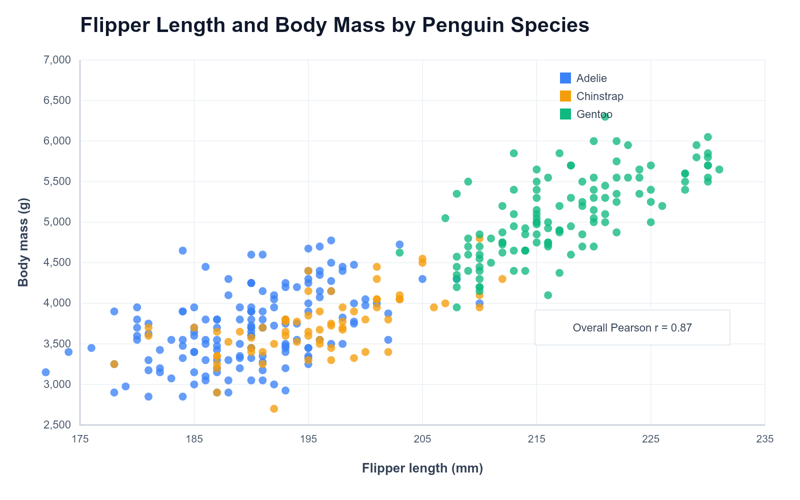

# CodeAlpha Task 3 — Penguin Data Visualization

A GitHub-ready Python visualization project for CodeAlpha Internship Task 3.
It turns the Palmer Penguins dataset used for Task 2 EDA into clear,
decision-oriented charts with **Pandas**, **Matplotlib**, and **Seaborn**.



## Project objective

The project answers focused questions about the penguin observations instead of
adding decorative charts:

- Which species has the highest average body mass?
- How are species observations distributed across the three islands?
- How do body-mass distributions and sex-group variation differ by species?
- Is flipper length associated with body mass?
- Which physical measurements are most closely related?

## Dataset

The project reuses `data/penguins.csv` from the accompanying CodeAlpha Task 2
EDA work. It is a simplified Palmer Penguins dataset with **344 observations**,
three species, three islands, four numeric measurements, and recorded sex where
available. The data were collected and made available by Dr. Kristen Gorman and
the Palmer Station, Antarctica LTER; see the official
[palmerpenguins documentation](https://allisonhorst.github.io/palmerpenguins/)
for attribution and context.

There is no date, year, or other time field. Therefore a line chart is not
appropriate and is intentionally not included.

## Project structure

```text
.
├── data/
│   ├── penguins.csv                 # raw input data
│   └── README.md                    # data dictionary and attribution
├── output/                          # six generated 300-DPI PNG charts
├── src/
│   └── visualize_penguins.py        # complete preparation + visualization workflow
├── requirements.txt
├── .gitignore
└── README.md
```

## Visual methodology

The script first validates the required columns, converts measurement columns
to numeric values with Pandas, and standardizes text labels. It does not fill
or fabricate missing measurements. Each chart uses only the non-missing values
needed for that question, while the source data remains unchanged.

| Chart | Analytical question | Why this chart type? |
| --- | --- | --- |
| `01_average_body_mass_by_species.png` | Which species is heaviest on average? | A bar chart makes three group means directly comparable. |
| `02_species_composition_by_island.png` | How do island samples divide across species? | A stacked bar chart shows both total observations and composition. |
| `03_body_mass_distribution.png` | What ranges and overlaps occur in body mass? | A histogram shows distribution shape, spread, and overlap. |
| `04_body_mass_by_species_and_sex.png` | How does mass vary within species by recorded sex? | A box plot compares medians, spread, and unusual values. |
| `05_flipper_length_vs_body_mass.png` | Is flipper length related to mass? | A scatter plot preserves individual observations and group clusters. |
| `06_measurement_correlation_heatmap.png` | Which numeric measurements co-vary? | A correlation heatmap summarizes all pairwise linear associations. |

All images are saved as PNGs at 300 DPI and use descriptive titles, labelled
axes, readable legends where groups are present, colour-consistent species
labels, and a restrained white-grid style.

## Key insights / data story

Run the script to reproduce the exact values printed from the CSV. The charts
tell a connected story:

1. The bar chart identifies which species has the largest average body mass,
   while the histogram and box plot show why a single all-penguin average is
   not enough: the species have visibly different ranges and within-species
   variation.
2. The island composition chart provides collection context. It prevents a
   reader from treating species and islands as interchangeable groups when
   interpreting the physical measurements.
3. The scatter plot and correlation heatmap connect the individual measurements:
   larger flippers are positively associated with greater body mass in this
   dataset, but the species colours show that the observations form distinct
   clusters.
4. For a field-summary or comparison workflow, keep species, island, and
   recorded sex attached to each measurement. Comparing only grand averages can
   hide the group structure shown by the visualizations.

These are descriptive observations about this CSV, not claims of causation or
predictions beyond the sampled penguins.

## How to run

1. Install Python 3.10 or newer.
2. From the project root, create and activate a virtual environment (optional):

   ```powershell
   py -m venv .venv
   .\.venv\Scripts\Activate.ps1
   ```

3. Install the dependencies:

   ```powershell
   py -m pip install -r requirements.txt
   ```

4. Generate the charts and console data story:

   ```powershell
   py src\visualize_penguins.py
   ```

The script overwrites the six chart images in `output/` so the visualizations
are always reproducible from the supplied CSV.

## CodeAlpha Task 3 requirement mapping

| Official requirement | Completed work |
| --- | --- |
| Transform raw data into visual formats | `visualize_penguins.py` loads the raw CSV with Pandas and creates six chart types. |
| Use Matplotlib, Seaborn, or Tableau | The project uses Pandas for preparation and both Matplotlib and Seaborn for plotting. |
| Design visuals that enhance understanding | Every visual maps to a stated question, has labelled axes/titles, and avoids decorative chart types. |
| Craft compelling data stories for decisions | The console `DATA STORY / KEY INSIGHTS` and this README connect the visuals to careful field-summary decisions. |
| Build a portfolio with impactful visualizations | High-resolution PNG outputs, a clean structure, data documentation, reproducible code, and a run guide are included. |
| Include appropriate chart types | Bar, histogram, box plot, scatter plot, and correlation heatmap are included. A line chart is correctly omitted because no time data exists. |
| Explain major visuals and insights | The script prints a short explanation after each chart; the methodology and data-story sections document the narrative. |
